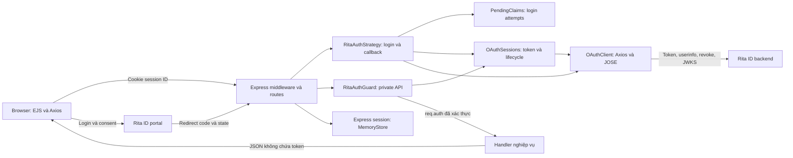

# Kiến trúc OAuth example

[README](README.md) · [Login và guard](docs/flows/01-login-and-guard.md) ·
[Private API](docs/flows/02-private-resource-request.md) ·
[Refresh và kết thúc phiên](docs/flows/03-refresh-and-session-termination.md)

## Mô hình hiện tại

Ứng dụng web có backend riêng, là confidential OAuth client của Rita Võ ID. EJS render giao diện;
Axios browser gọi API cùng origin. Backend giữ token và refresh tại Rita ID, không phát JWT riêng
cho frontend. Các store hiện đều ở RAM của một process.



## Thành phần và trách nhiệm

| Thành phần | Trách nhiệm | Source |
| --- | --- | --- |
| App | Wiring, headers, session, routes, errors | [app.ts](src/app.ts) |
| EJS / frontend | Shell, Axios API, textContent, xử lý 401 | [page.ejs](src/views/page.ejs), [app.js](src/public/app.js) |
| Strategy | State/PKCE, callback, regenerate session | [rita-auth.strategy.ts](src/auth/rita-auth.strategy.ts) |
| PendingClaims | Claim callback một lần, cancel khi logout | [pending-claims.ts](src/auth/pending-claims.ts) |
| Guard | Kiểm tra session, resolve identity, req.auth trước next() | [rita-auth.guard.ts](src/auth/rita-auth.guard.ts) |
| OAuthSessions | Token, deadline, version, refresh dùng chung, verification, revoke | [oauth-sessions.ts](src/auth/oauth-sessions.ts) |
| OAuthClient | Axios server-to-server, JOSE JWT/JWKS, parse profile | [oauth-client.ts](src/auth/oauth-client.ts), [profile.ts](src/auth/profile.ts) |
| Session middleware | Cookie, save/regenerate/destroy | [session.ts](src/auth/session.ts) |
| Routes | HTTP contract, CSRF, JSON/form, private handler | [auth/routes.ts](src/auth/routes.ts), [public.ts](src/routes/public.ts) |

Axios backend có timeout 10 giây, không theo redirect, không tự retry token endpoint.
JOSE tải JWKS theo cơ chế thư viện. Lỗi Axios được chuẩn hóa để không lộ request chứa secret.

## Ba lớp dữ liệu phiên

| Lớp | Dữ liệu | Vị trí hiện tại |
| --- | --- | --- |
| Browser cookie | Session ID được ký bởi express-session; không có token/profile | Cookie `rita_example.sid` |
| Express session | `oauthId`, CSRF, deadline, pending state/verifier, cookie metadata | MemoryStore |
| OAuth entry | Cặp token, identity, deadline, version, refresh/closing/failure | Map trong OAuthSessions |

`oauthId` trỏ tới entry có key bằng `req.sessionID`; guard kiểm tra hai giá trị khớp nhau.
Session ID ngẫu nhiên đổi sau login thành công, **khác user `_id`/`sub`**. Một user có thể có
nhiều phiên trên các browser/thiết bị. Lưu phiên không phải xây database user riêng; profile
vẫn từ Rita ID, không có password/onboarding local.

Profile trong entry phục vụ đối chiếu subject và metadata, không thay thế userinfo cho request
private mới. `req.auth` chỉ chứa `{ profile, expiresAt }`. Cookie HttpOnly, SameSite=Lax,
Path=/, không Domain; Secure khi cấu hình HTTPS. Browser không đọc được cookie bằng JavaScript.

## Middleware và cách dùng guard

`createApp()` tạo một OAuthClient, OAuthSessions và PendingClaims dùng chung:

1. Helmet, no-store và phục vụ asset local.
2. JSON/URL-encoded parsers.
3. Express session và cập nhật cookie maxAge theo deadline tuyệt đối.
4. Public/auth routes; private route gắn guard trước handler.
5. 404 và error handler; lỗi phiên 401 cleanup server/cookie.

Đây là **Express middleware dạng class**, không phải NestJS decorator hoặc Passport provider.
Ví dụ trong router đã nhận `sessions` dùng chung:

```ts
const auth = new RitaAuthGuard({ sessions });
router.get('/api/orders', auth.handle, (req, res) => {
  const subject = req.auth!.profile.sub;
  res.json({ subject }); // Nghiệp vụ chạy sau xác thực.
});
```

Không tạo store mới mỗi request/router; không đặt guard trước callback. Guard xác thực danh tính;
quyền nghiệp vụ/group và CSRF cho API ghi là trách nhiệm bổ sung. Refresh/logout đã có CSRF.

## Thời hạn và giới hạn

- Access expiry lấy từ JWT đã xác minh; không suy từ expires_in, không refresh sớm dưới 30 giây.
- Local deadline mặc định 8 giờ, không kéo dài khi refresh. Không có refresh token thì deadline
  không vượt quá hạn access token. Timer chỉ cleanup, không refresh nền.
- Hạn OAuth session phía Rita ID độc lập; response không cung cấp hạn refresh để hiển thị.
- Restart mất MemoryStore, OAuthSessions, PendingClaims. Timer không chạy lúc process down;
  OAuth session phía Rita ID chưa revoke có thể còn hiệu lực. Không chạy nhiều worker/instance.
- Userinfo hiện đọc database Rita ID, không đồng bộ HRM hoặc kiểm tra OAuth-session revoke từng
  request. Fresh userinfo không bảo đảm phát hiện ngay mọi revoke hoặc HRM inactive.
- Adapter xác minh RS256, audience client ID, exp, UUID subject và subject userinfo. Không giả định
  issuer/discovery/token purpose chưa có trong contract. ID token bị bỏ qua; chưa phải OIDC đầy đủ.
- Logout thử revoke OAuth session, không logout SSO; access JWT đã cấp không nhất thiết mất hiệu lực
  ngay. Chi tiết lỗi: [refresh và kết thúc phiên](docs/flows/03-refresh-and-session-termination.md).

<a id="luu-tru-ben-vung"></a>
## Lưu trữ bền vững khi triển khai thực tế

> In-memory store hiện tại chỉ dành cho demo. Khi triển khai thực tế, cần lưu cặp token và dữ liệu
> phiên liên quan trong kho độc lập với process ứng dụng, như Redis được cấu hình persistence
> phù hợp hoặc PostgreSQL với lưu trữ bền vững, để phiên không mất chỉ vì ứng dụng restart,
> redeploy hoặc downtime. Repository hiện **chưa triển khai Redis/PostgreSQL**.

| Yêu cầu | Ý nghĩa |
| --- | --- |
| Phiên đầy đủ | Lưu Express session, ánh xạ/token entry, deadline, version, subject và trạng thái cần phục hồi; chỉ đổi MemoryStore chưa đủ |
| Secret ổn định | Giữ SESSION_SECRET qua restart để cookie hiện có vẫn xác minh được |
| Tính bền vững | Redis cần persistence, volume, phục hồi và eviction phù hợp; PostgreSQL cần lưu trữ/backup phù hợp, không dựa vào disk tạm container |
| TTL/cleanup | Server kiểm tra deadline tuyệt đối; cleanup không phụ thuộc riêng timer của process |
| Cập nhật nguyên tử | Ghi cặp token cùng version/trạng thái, tránh đọc access token mới với refresh token cũ |
| Nhiều instance | Khóa/cập nhật có điều kiện, nhận biết version, xử lý worker chết; promise RAM không phải distributed lock |
| Store outage | Trả lỗi tạm thời; không cho vào handler bằng profile cache hoặc tự coi request đã xác thực |
| Bảo vệ credentials | Giới hạn quyền đọc/ghi, bảo vệ đường truyền/dữ liệu lưu trữ; không lộ token qua log hoặc backup |

Muốn tiếp tục login đang dở qua restart/nhiều instance, state/verifier và registry claim/cancel
cũng cần lưu và điều phối chung, bảo đảm claim một lần. Không serialize nguyên promise/timer hiện
tại thành dữ liệu database.

Kho bền vững **không bảo đảm phiên sống qua mọi sự cố**: Rita ID có thể đã rotate nhưng ứng dụng
crash trước khi lưu replacement. Không có transaction nguyên tử xuyên hai hệ thống; retry token
cũ có thể bị coi là reuse. Cần policy phục hồi rõ ràng và có trường hợp phải login lại. Downtime
cũng không dừng expiry. Đây là hướng thiết kế tương lai, chưa phải khả năng đã có trong example.

## Nguồn kiểm chứng

[App tests](test/app.test.ts), [guard tests](test/rita-auth.guard.test.ts),
[adapter tests](test/oauth.test.ts), [lifecycle tests](test/lifecycle.test.ts) và
[browser smoke](test/browser-smoke.mjs). Xem [README](README.md) cho lệnh chạy và kết quả đã ghi nhận.
