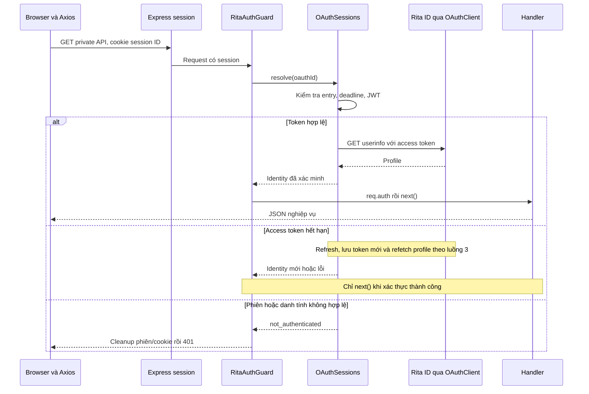

# Luồng 2: Frontend gọi private resource

[README](../../README.md) · [Kiến trúc](../../ARCHITECTURE.md) ·
[Login và guard](01-login-and-guard.md) · [Refresh/logout](03-refresh-and-session-termination.md)

## Mục đích và đầu vào

Mỗi private request phải có danh tính đã xác minh trước khi vào handler. Browser đã login,
giữ cookie session ID và gọi API example cùng origin bằng Axios. Backend có phiên tương ứng.
Không cần frontend lấy hay gắn Bearer token; guard hiện không nhận OAuth Bearer từ browser.

## Các bước xử lý

1. Axios gọi `/api/me` hoặc `/api/private/example`; browser tự gửi cookie HttpOnly cùng origin.
   Cookie HttpOnly không đọc được bằng JavaScript nhưng vẫn được browser gửi trong HTTP request.
2. Express session middleware đọc cookie, kiểm tra chữ ký và nạp session. Guard xóa `req.auth`
   cũ, yêu cầu `oauthId` tồn tại và bằng `req.sessionID`.
3. `OAuthSessions.resolve()` tra entry, từ chối phiên thiếu/đang đóng/quá deadline hoặc đã thất bại.
   Nếu có refresh đang chạy thì chờ; nếu có verification pending thì phục hồi theo policy refresh.
4. OAuthClient xác minh access JWT (RS256, audience, expiry, subject), gọi Rita ID
   `/auth/oauth/userinfo` với access token. Profile được parse/allowlist, `_id` map thành `sub`;
   subject phải trùng JWT và người dùng đã xác minh của phiên.
5. Profile mới được dùng cho request; profile cache không cho phép đi tiếp khi Rita ID lỗi.
   Token hết hạn chuyển sang [luồng refresh](03-refresh-and-session-termination.md), chưa chạy handler.
6. Guard gắn `req.auth`, gọi `next()`. Handler dùng `req.auth.profile`, trả JSON không chứa token.
7. Frontend cập nhật DOM bằng `textContent`; có thể gọi `/api/session` để cập nhật metadata.



## Endpoint minh họa

| Endpoint | Xác thực và kết quả |
| --- | --- |
| `GET /api/me` | Guard gọi userinfo; trả profile với sub và các field được cho phép |
| `GET /api/private/example` | Cùng guard; handler trả `{ message, subject }` từ req.auth |
| `GET /api/session` | Kiểm tra phiên local và đọc metadata; không gọi profile hoặc refresh |

`/api/session` không phải bằng chứng danh tính mới nhất từ Rita ID. Nó có thể trả metadata khi
access token hết hạn nhưng phiên còn khả năng refresh, hoặc khi verification đang pending.
Metadata gồm accessExpiresAt, sessionExpiresAt, canRefresh, scopes, refreshCount, lastRefreshAt,
verificationPending; timestamp là epoch milliseconds, lastRefreshAt ban đầu null.
Không có token, session ID hoặc CSRF trong response metadata.

Ví dụ handler hiện tại có thứ tự:

```ts
router.get('/api/me', auth.handle, (req, res) => res.json(req.auth!.profile));
```

Guard giải quyết **danh tính**, không tự cấp **quyền nghiệp vụ**. Ví dụ biết subject không đồng
nghĩa được đọc tất cả orders; handler hoặc middleware quyền phải kiểm tra quyền sở hữu/quyền nhóm.
CSRF là kiểm tra riêng cho thao tác ghi dùng cookie. Hai private endpoint mẫu là GET;
refresh/logout đã có CSRF, API ghi mới cần thiết kế kiểm tra tương ứng.

## Lỗi và frontend

| Kết quả | Hành vi |
| --- | --- |
| 401 not_authenticated | Backend cleanup phiên/cookie; interceptor xóa UI và chuyển về `/` một lần |
| Userinfo 401 khi JWT chưa hết hạn | Không refresh mù; từ chối danh tính và kết thúc phiên |
| 403 forbidden | Không chạy handler, không refresh và không tự logout |
| 502 integration_error | Hiển thị lỗi tích hợp, không redirect login lặp |
| 503 temporarily_unavailable | Không dùng profile cache; hiển thị lỗi và Retry-After nếu có |
| Lỗi mạng phía frontend | Hiển thị lỗi; không mặc định coi phiên hết hạn |

Interceptor không gọi refresh hoặc replay private request. Khi backend refresh thành công,
request ban đầu tiếp tục vào handler đúng một lần. Frontend bỏ cập nhật UI từ response cũ sau
khi bắt đầu logout bằng epoch; không để response muộn phục hồi trạng thái đăng nhập.

Gọi userinfo mỗi request vẫn chịu [giới hạn Rita ID](../../ARCHITECTURE.md): profile phản ánh dữ
liệu Rita ID đang trả, không bảo đảm đồng bộ HRM hay kiểm tra OAuth revoke tức thời.

## Source và kiểm chứng

- [Public/private routes](../../src/routes/public.ts), [guard](../../src/auth/rita-auth.guard.ts),
  [OAuth client](../../src/auth/oauth-client.ts), [frontend Axios](../../src/public/app.js).
- [Lifecycle tests](../../test/lifecycle.test.ts): fresh profile mỗi request, không refresh sớm,
  userinfo 401/403/503, private resource, cookie không thay qua refresh.
- [Adapter tests](../../test/oauth.test.ts): chữ ký, audience, subject, userinfo mismatch.
- [Browser smoke](../../test/browser-smoke.mjs): private API, DOM escaping, lỗi và điều hướng 401.
