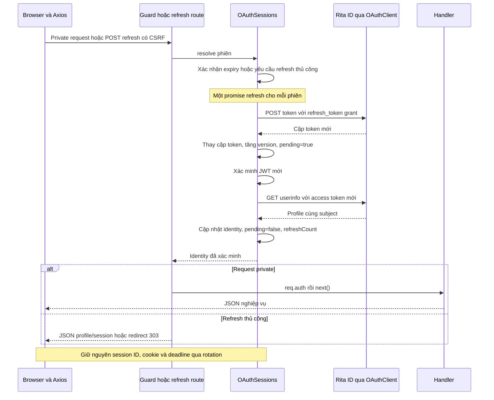
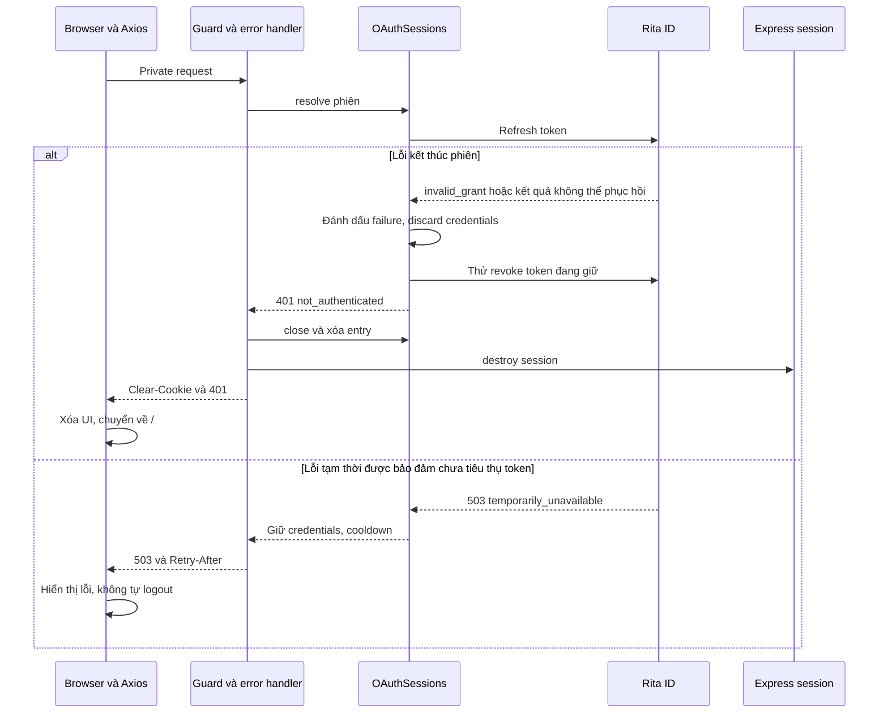

# Luồng 3: Refresh, cập nhật token, refetch profile và kết thúc phiên

[README](../../README.md) · [Kiến trúc](../../ARCHITECTURE.md) ·
[Login/guard](01-login-and-guard.md) · [Private API](02-private-resource-request.md)

## Mục đích và điều kiện

Backend dùng refresh token của Rita ID để thay cặp token trong **cùng phiên**, lấy lại profile
rồi cho phép request tiếp tục. Browser không nhận token mới và không cần thay cookie chỉ vì
rotation. Session ID và deadline tuyệt đối giữ nguyên.

Phiên phải tồn tại, chưa đóng/hết deadline, có refresh token; không vi phạm cooldown hoặc lỗi
đã đánh dấu. Không có refresh token thì phiên không sống quá access expiry; refresh thủ công
trả 409 khi phiên còn tồn tại nhưng không có khả năng refresh.

Hai điểm kích hoạt:

- **Tự động:** guard gặp `AccessExpiredError` khi xác minh JWT hoặc token hết hạn trong lúc gọi
  userinfo. JWT sai chữ ký/audience/subject không được xem là expiry. Userinfo 401 chỉ được xem
  như expiry khi hạn của JWT đã xác minh thực sự đã qua.
- **Thủ công:** browser POST `/auth/refresh` của example, có CSRF. Backend gọi
  `resolve(oauthId, true)`. Endpoint Rita ID được gọi vẫn là `/auth/oauth/token`, không phải
  `/auth/refresh` của hệ thống SSO.

## Refresh thành công

1. Nếu có refresh đang chạy cho cùng entry, chờ promise đó. Nếu token version đã đổi do request
   khác, dùng credentials mới thay vì gửi lại refresh token cũ.
2. OAuthClient POST JSON tới Rita ID `/auth/oauth/token` với `grant_type=refresh_token`,
   refresh token hiện có, client ID và client secret. Không tự retry request token endpoint.
3. Kiểm tra response có Bearer access token và replacement refresh token hợp lệ.
4. **Ghi ngay cả cặp token mới vào entry**, tăng version, đặt pending=true trước khi await JWT/userinfo.
   Đây hiện là cập nhật RAM; không phải transaction lưu trữ bền vững.
5. Xác minh JWT mới và expected subject, gọi userinfo bằng access token mới, kiểm tra subject
   profile. Token mới không được đổi người dùng hoặc đã hết hạn.
6. Cập nhật identity, bỏ pending/cooldown, tăng refreshCount và cập nhật lastRefreshAt sau khi
   xác minh thành công. Không thay deadline/session ID.
7. Với request private: guard gắn req.auth và gọi handler. Chỉ refetch profile, không gọi lại toàn
   bộ API nghiệp vụ. Với refresh thủ công: JSON trả `{ profile, session }`; form redirect 303 về `/`.

## Concurrency và xác minh pending

Rita ID rotate refresh token; reuse có thể revoke cả OAuth session. Promise `flight` dùng chung
trong một process tránh các request/tab gửi cùng refresh token đồng thời. Request chờ rotation
vẫn phải lấy profile trước handler. Version giúp bỏ kết quả/lỗi từ token cũ trả về muộn.
Nếu rotation liên tục làm kết quả xác minh bị supersede, code giới hạn retry và có thể trả 503
với Retry-After 1 giây; không lặp vô hạn.

Sau khi token mới đã ghi, lỗi JWKS/userinfo tạm thời đặt cooldown 5 giây và giữ pending=true.
Lần thử sau xác minh **token mới đang có**, không gọi refresh grant lần nữa. Trong thời gian đó,
không dùng profile cũ để vào handler. `accessExpiresAt` vẫn là hạn identity đã xác minh trước;
refreshCount/lastRefreshAt chưa tăng. Nếu replacement hết hạn trước khi xác minh thành công,
phiên kết thúc, không tiếp tục rotation để che lỗi.

Đây là điều phối trong RAM, chưa bảo vệ giữa các process/instance. Xem
[lưu trữ bền vững](../../ARCHITECTURE.md#luu-tru-ben-vung): cần cả kho phiên chung, cập nhật nguyên tử,
khóa/version và phục hồi sự cố; Redis đơn thuần không tự giải quyết refresh race.

## Phân loại lỗi theo code hiện tại

Các status dưới đây là response API; request form nhận trang lỗi HTML tương ứng.

| Lỗi / giai đoạn | Backend | Frontend |
| --- | --- | --- |
| Refresh invalid_grant hoặc không còn phiên hợp lệ | 401 not_authenticated, vô hiệu credentials và cleanup phiên/cookie | Xóa UI, về `/` |
| JWT sai chữ ký/audience/subject; userinfo 400/401 không do expiry | Từ chối identity, 401, cleanup | Xóa UI, về `/` |
| Replacement hết hạn/subject thay đổi | 401; không rotate tiếp, cố revoke replacement | Xóa UI, về `/` |
| Refresh trả đúng 503 temporarily_unavailable | Giữ credentials, cooldown 5 giây, 503 và Retry-After | Hiển thị lỗi, không tự logout |
| Refresh timeout/mất response/500/response hỏng | Không biết token cũ đã bị tiêu thụ; kết thúc phiên, cố revoke token đang giữ, 401 | Xóa UI, về `/` |
| invalid_client, invalid_scope, unauthorized_client, unsupported_grant_type, invalid_request khi refresh | Đánh dấu failure 502 integration_error, discard credentials và cố revoke; không tự clear cookie theo nhánh 401 | Hiển thị lỗi tích hợp, không tự logout/login lặp |
| Lỗi JWKS tạm thời được adapter nhận diện, userinfo network/5xx | 503 và cooldown 5 giây; sau rotation giữ replacement pending | Hiển thị lỗi, không dùng cached profile để đi tiếp |
| Userinfo 403 | 403 forbidden; không rotate vì lỗi này, không tự kết thúc phiên; sau rotation vẫn giữ pending | Hiển thị lỗi quyền, không logout |
| Manual refresh không có refresh token | 409 refresh_unavailable nếu phiên còn hiệu lực | Hiển thị không thể refresh |
| CSRF thiếu/sai trên refresh/logout | 403 invalid_csrf, không thực hiện thao tác | Hiển thị lỗi/tải lại trang |

**Không phải mọi refresh failure đều logout.** Nhánh lỗi cấu hình 502 hiện giữ entry đã đánh dấu
failure cho đến logout/expiry; credentials đã bị discard nên phiên đó không tự phục hồi chỉ bằng
retry. Cần sửa cấu hình tích hợp trước; không khẳng định đây là phiên vẫn sử dụng bình thường.
CSRF được kiểm tra trước logic refresh/logout, nên request dùng CSRF cũ sau khi phiên đã bị hủy
có thể trả 403 thay vì 401.

## Kết thúc phiên tự động khi lỗi không thể phục hồi

1. Store đánh dấu failure hoặc đóng phiên, không cho handler chạy.
2. Bỏ credentials local và thử revoke refresh token đang giữ. Revoke là best effort, không có
   hàng đợi retry; nếu response refresh đã mất thì backend có thể chỉ còn token cũ.
3. Guard/error handler xử lý 401: đóng entry, destroy Express session, clear cookie và trả
   `{ error: 'not_authenticated' }`. Nếu cleanup Express session lỗi thì có thể trả 500.
4. Axios interceptor nhận 401 đúng mã, xóa profile/session/result khỏi UI và điều hướng `/` một lần.
   **Không cần frontend gọi `/auth/logout` thêm**, backend đã thực hiện cleanup.

## Logout chủ động

Người dùng POST `/auth/logout` với CSRF. Backend hủy pending login claims, đánh dấu entry
closing, chờ refresh đang chạy rồi revoke token mới nhất. Sau đó xóa entry, destroy Express session,
clear cookie. Callback/refresh muộn không khôi phục identity.

JSON response là `{ loggedOut: true, revokeConfirmed }`; form redirect 303 về `/`, hoặc
`/?notice=revoke_unconfirmed` nếu chưa xác nhận revoke. Dù revoke lỗi vẫn xóa phiên local.
Frontend tăng epoch khi bắt đầu logout để bỏ response cũ, điều hướng sau response thành công.
Logout ứng dụng không logout SSO Rita ID và không bảo đảm access JWT đã cấp mất hiệu lực ngay.

## Source và kiểm chứng

- [OAuthSessions](../../src/auth/oauth-sessions.ts), [OAuthClient](../../src/auth/oauth-client.ts),
  [guard](../../src/auth/rita-auth.guard.ts), [auth routes](../../src/auth/routes.ts),
  [error handler](../../src/app.ts), [Axios frontend](../../src/public/app.js).
- [Lifecycle tests](../../test/lifecycle.test.ts): rotation, cùng promise, late response, pending
  verification, 503/cooldown, mất response, changed subject, logout races và revoke thất bại.
- [Adapter tests](../../test/oauth.test.ts): expiry trong lúc gọi profile, lỗi/timeout, token response hỏng.
- [Browser smoke](../../test/browser-smoke.mjs): refresh tự động/thủ công, cookie giữ nguyên,
  503 recovery, logout, 401 redirect.

> Production cần token và dữ liệu phiên trong kho độc lập với process, không dùng in-memory như
> demo. Redis phải có persistence phù hợp hoặc dùng PostgreSQL bền vững. Crash giữa Rita ID rotation
> và ghi replacement vẫn có thể buộc login lại; xem [kiến trúc](../../ARCHITECTURE.md#luu-tru-ben-vung).
